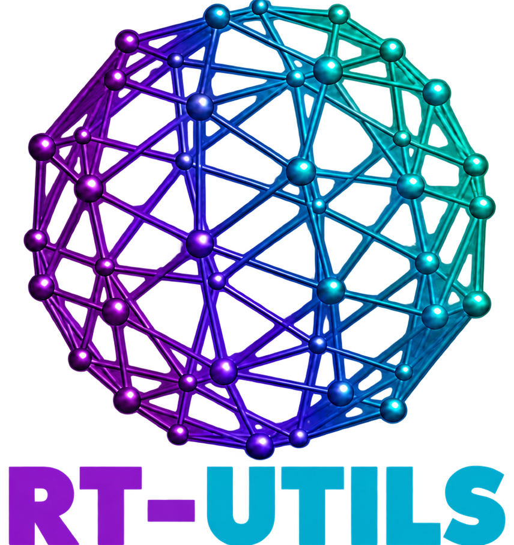
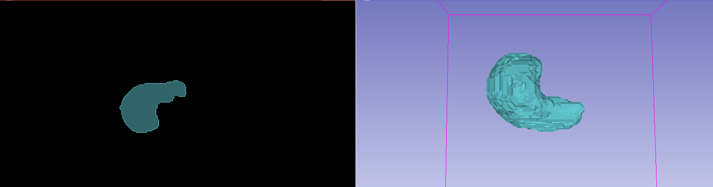

<p align="center">
  
</p>
<p align="center">
  <em>A minimal Python library for RT Struct manipulation</em>
</p>
<p align="center">
    
    
    <a href="https://pypi.org/project/rt-utils"></a>
    <a href="https://rt-utils.readthedocs.io/en/latest/"></a>
    
</p>

---

[](https://doi.org/10.5281/zenodo.14902966)

RT-Utils reads and writes the DICOM **RT Structure Set**, the file a treatment planning system stores contoured anatomy in. It turns an RTStruct into a NumPy mask you can compute on, and turns a mask from a segmentation model back into a conformant RTStruct that a planning system or viewer will open.

## Installation

```bash
pip install rt-utils
```

NIfTI conversion needs SimpleITK, which is an optional extra:

```bash
pip install "rt-utils[nifti]"
```

Python 3.9 and newer.

## Writing a mask into a structure set

```python
from rt_utils import RTStructBuilder

rtstruct = RTStructBuilder.create_new(dicom_series_path="./series")

# Your segmentation, as a boolean array shaped (Rows, Columns, Slices)
rtstruct.add_roi(mask=MASK_FROM_ML_MODEL, name="GTV", color=[255, 0, 255])

rtstruct.save("new-rt-struct")
```

<p align="center">
  
</p>
<p align="center">
  An ROI written from a liver segmentation model, as viewed in Slicer. (The underlying patient data has been hidden.)
</p>

## Reading one back as a mask

```python
from rt_utils import RTStructBuilder

rtstruct = RTStructBuilder.create_from(
    dicom_series_path="./series",
    rt_struct_path="./series/rt-struct.dcm",
)

print(rtstruct.get_roi_names())
mask = rtstruct.get_roi_mask_by_name("GTV")   # (Rows, Columns, Slices), bool
```

## Mask layout

A mask is indexed `(Rows, Columns, Slices)`:

| axis | index | runs |
| --- | --- | --- |
| 0 | row | down a column |
| 1 | column | along a row |
| 2 | slice | through the series in ascending slice position |

The first two axes are ordered exactly as pydicom reads `pixel_array`, so a mask produced by segmenting the series already has the right layout. A mask from elsewhere, a NIfTI volume in particular, carries its own axis order and direction and may need rearranging first: see [Mask layout](https://rt-utils.readthedocs.io/en/latest/concepts/mask-layout.html), and use [`nifti_to_mask`](https://rt-utils.readthedocs.io/en/latest/guide/nifti.html) rather than guessing a transpose.

## What else it does

- [Convert a NIfTI segmentation](https://rt-utils.readthedocs.io/en/latest/guide/nifti.html) onto the series grid, reading both affines, with `label=` to select one structure from a multi-label file
- [Write contours from coordinates](https://rt-utils.readthedocs.io/en/latest/guide/coordinates.html) in patient or pixel space, rather than from a mask
- [Work entirely in memory](https://rt-utils.readthedocs.io/en/latest/guide/in-memory.html), passing pydicom datasets in and getting a `BytesIO` out
- [Manage ROIs](https://rt-utils.readthedocs.io/en/latest/guide/managing-rois.html): colours, names, `delete_roi`, and `RTROIInterpretedType` so a planning system can tell a target from an organ at risk
- [Smooth masks](https://rt-utils.readthedocs.io/en/latest/guide/smoothing.html) before contouring, with a hook for your own implementation
- [Merge two structure sets](https://rt-utils.readthedocs.io/en/latest/guide/merging.html) drawn on the same series
- [Read a series held in a single file](https://rt-utils.readthedocs.io/en/latest/concepts/multi-frame.html): a reconstructed SPECT, or an Enhanced CT, MR or PET

## 📖 Documentation

**[rt-utils.readthedocs.io](https://rt-utils.readthedocs.io/en/latest/)**: quickstart, guides, concepts and the full API reference.

Worth reading before your first `add_roi`: [Mask layout](https://rt-utils.readthedocs.io/en/latest/concepts/mask-layout.html). If something already looks wrong, start at [Troubleshooting](https://rt-utils.readthedocs.io/en/latest/guide/troubleshooting.html).

## Examples

A comparison between RT-Utils and other conversion techniques is in [this repository](https://github.com/qurit/dicom_nifti_conversion_project).

The real-world example from the JOSS paper was generated with [RTUTILS_read_world_example_for_PET.ipynb](https://github.com/qurit/rt-utils/blob/main/RTUTILS_read_world_example_for_PET.ipynb).

## Contributing

Contributions are welcome. Please review our [CONTRIBUTING guidelines](./CONTRIBUTING.md), and see [the changelog](https://rt-utils.readthedocs.io/en/latest/changelog.html) for what has changed recently.

## How to Cite

If you are incorporating RT-Utils into your projects, kindly include the following citation:

[](https://doi.org/10.21105/joss.07361)

Shrestha, A., A. Watkins, F. Yousefirizi, A. Rahmim, C. Uribe, "RT-utils: A minimal python library for RT-struct manipulation." Journal of Open Source Software, Vol. 10 (No. 107), pp. 7361, (2025). doi:10.21105/joss.07361.

Read the full paper: [RT-utils: A Minimal Python Library for RT-struct Manipulation](https://joss.theoj.org/papers/10.21105/joss.07361).
